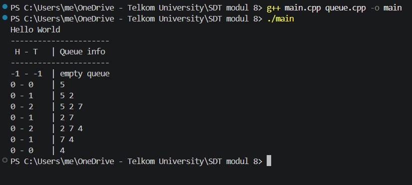
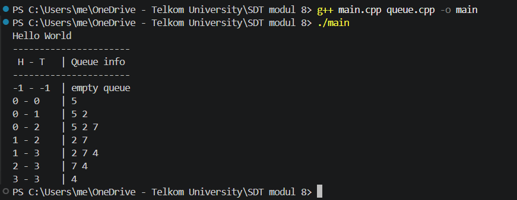
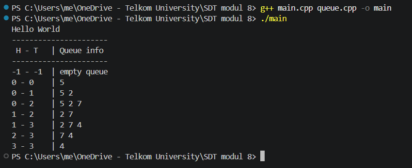

# <h1 align="center">Laporan Praktikum Modul 8 - Queue</h1>
<p align="center">Ignatius Steven Manurung - 109082500089</p>

## Dasar Teori
Queue (antrean) merupakan struktur data linear yang bekerja berdasarkan prinsip First In, First Out (FIFO), yaitu elemen yang pertama kali masuk ke dalam antrean akan menjadi elemen pertama yang keluar. Struktur data ini memiliki dua operasi dasar, yakni enqueue untuk menambahkan elemen baru pada ujung belakang (tail) dan dequeue untuk menghapus elemen pada ujung depan (head). Dalam pengimplementasiannya menggunakan array (representasi tabel), kapasitas penampungan data bersifat statis sesuai ukuran maksimum indeks yang dialokasikan. Pengelolaan posisi head dan tail pada array dapat diatur melalui beberapa pendekatan, mulai dari pergeseran elemen secara linear hingga pemanfaatan indeks melingkar (circular buffer) agar penggunaan ruang memori lebih optimal. 

## Unguided 

### 1. Buatlah implementasi ADT Queue pada file “queue.cpp” dengan menerapkan mekanisme queue  Alternatif 1 (head diam, tail bergerak). 

```C++
//queue.h
#ifndef QUEUE_H_INCLUDED
#define QUEUE_H_INCLUDED

#include <iostream>
using namespace std;

const int MAX = 5;
typedef int infotype;

struct Queue {
    infotype info[MAX];
    int head, tail;
};

void createQueue(Queue &Q);
bool isEmptyQueue(Queue Q);
bool isFullQueue(Queue Q);
void enqueue(Queue &Q, infotype x);
infotype dequeue(Queue &Q);
void printInfo(Queue Q);

#endif

//queue.cpp
#include "queue.h"

void createQueue(Queue &Q) {
    Q.head = -1;
    Q.tail = -1;
}

bool isEmptyQueue(Queue Q) {
    return (Q.head == -1 && Q.tail == -1);
}

bool isFullQueue(Queue Q) {
    return (Q.tail == MAX - 1);
}

void enqueue(Queue &Q, infotype x) {
    if (isFullQueue(Q)) {
        cout << "Queue penuh!" << endl;
    } else if (isEmptyQueue(Q)) {
        Q.head = 0;
        Q.tail = 0;
        Q.info[Q.tail] = x;
    } else {
        Q.tail++;
        Q.info[Q.tail] = x;
    }
}

infotype dequeue(Queue &Q) {
    if (isEmptyQueue(Q)) {
        cout << "Queue kosong!" << endl;
        return -1;
    } else {
        infotype x = Q.info[Q.head];
        if (Q.head == Q.tail) {
            Q.head = -1;
            Q.tail = -1;
        } else {
            for (int i = Q.head; i < Q.tail; i++) {
                Q.info[i] = Q.info[i + 1];
            }
            Q.tail--;
        }
        return x;
    }
}

void printInfo(Queue Q) {
    cout << Q.head << " - " << Q.tail << "\t | ";
    if (isEmptyQueue(Q)) {
        cout << "empty queue";
    } else {
        for (int i = Q.head; i <= Q.tail; i++) {
            cout << Q.info[i] << " ";
        }
    }
    cout << endl;
}

//main.cpp
#include <iostream>
#include "queue.h"

using namespace std;

int main() {
    cout << "Hello World" << endl;
    Queue Q;
    createQueue(Q);
    cout << "----------------------" << endl;
    cout << " H - T \t | Queue info" << endl;
    cout << "----------------------" << endl;
    printInfo(Q);
    enqueue(Q, 5); printInfo(Q);
    enqueue(Q, 2); printInfo(Q);
    enqueue(Q, 7); printInfo(Q);
    dequeue(Q); printInfo(Q);
    enqueue(Q, 4); printInfo(Q);
    dequeue(Q); printInfo(Q);
    dequeue(Q); printInfo(Q);
    return 0;
}
```
### Output Unguided 1 :

##### Output 1


Pada Latihan 1 (Alternatif 1), indeks head selalu dipertahankan tetap pada posisi awal (0) selama antrean tidak kosong, sementara tail bergerak maju setiap kali fungsi enqueue dijalankan. Ketika fungsi dequeue dipanggil, nilai pada indeks head diambil dan seluruh elemen di belakangnya digeser maju satu langkah ke kiri diikuti dengan pengurangan nilai tail, sehingga susunan data selalu rapat di awal indeks meskipun memerlukan perulangan untuk menggeser elemen.

### 2. Buatlah implementasi ADT Queue pada file “queue.cpp” dengan menerapkan mekanisme queue  Alternatif 2 (head bergerak, tail bergerak).

```C++
#include "queue.h"

void createQueue(Queue &Q) {
    Q.head = -1;
    Q.tail = -1;
}

bool isEmptyQueue(Queue Q) {
    return (Q.head == -1 && Q.tail == -1);
}

bool isFullQueue(Queue Q) {
    return (Q.head == 0 && Q.tail == MAX - 1);
}

void enqueue(Queue &Q, infotype x) {
    if (isFullQueue(Q)) {
        cout << "Queue penuh!" << endl;
    } else if (isEmptyQueue(Q)) {
        Q.head = 0;
        Q.tail = 0;
        Q.info[Q.tail] = x;
    } else {
        if (Q.tail == MAX - 1) {
            int j = 0;
            for (int i = Q.head; i <= Q.tail; i++) {
                Q.info[j] = Q.info[i];
                j++;
            }
            Q.tail = Q.tail - Q.head;
            Q.head = 0;
        }
        Q.tail++;
        Q.info[Q.tail] = x;
    }
}

infotype dequeue(Queue &Q) {
    if (isEmptyQueue(Q)) {
        cout << "Queue kosong!" << endl;
        return -1;
    } else {
        infotype x = Q.info[Q.head];
        if (Q.head == Q.tail) {
            Q.head = -1;
            Q.tail = -1;
        } else {
            Q.head++;
        }
        return x;
    }
}

void printInfo(Queue Q) {
    cout << Q.head << " - " << Q.tail << "\t | ";
    if (isEmptyQueue(Q)) {
        cout << "empty queue";
    } else {
        for (int i = Q.head; i <= Q.tail; i++) {
            cout << Q.info[i] << " ";
        }
    }
    cout << endl;
}
```
### Output Unguided 2 :

##### Output 1


Pada Latihan 2 (Alternatif 2), operasi dequeue bekerja lebih cepat karena hanya perlu memajukan indeks head ke kanan tanpa menggeser elemen yang tersisa. Namun, mekanisme ini berpotensi menimbulkan kondisi penuh semu ketika tail sudah mencapai indeks terakhir (MAX - 1) padahal masih ada ruang kosong di depan head, sehingga fungsi enqueue dilengkapi mekanisme pergeseran seluruh elemen kembali ke indeks awal sebelum menyisipkan data baru.

### 3. Buatlah implementasi ADT Queue pada file “queue.cpp” dengan menerapkan mekanisme queue  Alternatif 3 (head dan tail berputar).

```C++
#include "queue.h"

void createQueue(Queue &Q) {
    Q.head = -1;
    Q.tail = -1;
}

bool isEmptyQueue(Queue Q) {
    return (Q.head == -1 && Q.tail == -1);
}

bool isFullQueue(Queue Q) {
    return ((Q.tail + 1) % MAX == Q.head);
}

void enqueue(Queue &Q, infotype x) {
    if (isFullQueue(Q)) {
        cout << "Queue penuh!" << endl;
    } else if (isEmptyQueue(Q)) {
        Q.head = 0;
        Q.tail = 0;
        Q.info[Q.tail] = x;
    } else {
        Q.tail = (Q.tail + 1) % MAX;
        Q.info[Q.tail] = x;
    }
}

infotype dequeue(Queue &Q) {
    if (isEmptyQueue(Q)) {
        cout << "Queue kosong!" << endl;
        return -1;
    } else {
        infotype x = Q.info[Q.head];
        if (Q.head == Q.tail) {
            Q.head = -1;
            Q.tail = -1;
        } else {
            Q.head = (Q.head + 1) % MAX;
        }
        return x;
    }
}

void printInfo(Queue Q) {
    cout << Q.head << " - " << Q.tail << "\t | ";
    if (isEmptyQueue(Q)) {
        cout << "empty queue";
    } else {
        int i = Q.head;
        while (true) {
            cout << Q.info[i] << " ";
            if (i == Q.tail) break;
            i = (i + 1) % MAX;
        }
    }
    cout << endl;
}
```
### Output Unguided 3 :

##### Output 1


Pada Latihan 3 (Alternatif 3), antrean dirancang menggunakan konsep circular queue dengan menerapkan operasi sisa bagi (% MAX) pada pergerakan indeks head maupun tail. Pemanfaatan operator modulo membuat kedua indeks dapat berputar kembali ke indeks 0 setelah mencapai batas akhir array, sehingga antrean terbebas dari kondisi penuh semu dan seluruh operasi berjalan konstan tanpa pergeseran elemen.

## Kesimpulan
Implementasi struktur data queue menggunakan array memiliki tingkat efisiensi yang berbeda tergantung pada mekanisme pengelolaan indeks head dan tail. Alternatif 1 dan Alternatif 2 masih membebani kinerja program dengan proses pergeseran elemen saat penghapusan data maupun saat terjadi penuh semu, sedangkan Alternatif 3 (circular queue) merupakan metode paling efisien karena mampu memanfaatkan seluruh slot memori array secara berputar tanpa melakukan pergeseran elemen sama sekali.

## Referensi
Cormen, T. H., Leiserson, C. E., Rivest, R. L., & Stein, C. (2009). Introduction to Algorithms (3rd ed.). Cambridge: MIT Press.

Rosa, A. S., & Shalahuddin, M. (2010). Modul Pembelajaran Struktur Data. Bandung: Modula.

Weiss, M. A. (2014). Data Structures and Algorithm Analysis in C++ (4th ed.). Boston: Pearson.